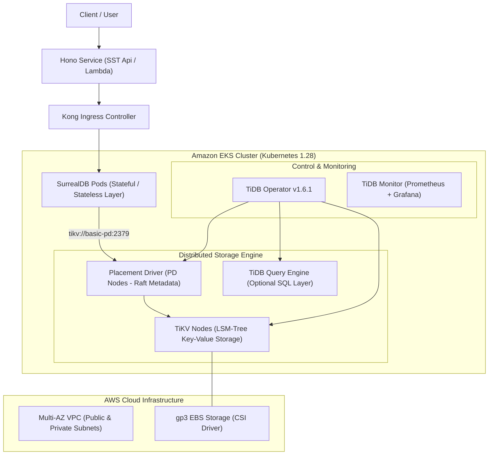

# Deployment & Operational Guide: SurrealDB on TiKV via SST / Pulumi on AWS EKS

This guide details the complete deployment architecture, configuration steps, and operational verification for running **SurrealDB backed by a distributed TiKV cluster** on Amazon EKS using **SST / Pulumi**.

---

## 1. Architecture Overview



---

## 2. Prerequisites & Environment Setup

1. **AWS Account & Permissions:**
   - Permissions for `EKS`, `EC2`, `VPC`, `IAM`, and `CloudFormation`.
   - AWS CLI v2 installed and configured (`aws configure`).

2. **Local Tooling:**
   - Node.js >= 18.0.0
   - `pnpm` >= 8.0.0 or `npm` >= 9.0.0
   - `kubectl` and `helm` v3.

3. **Required Environment Variables:**
   ```bash
   export AWS_REGION="us-east-1"
   export SURREALDB_URL="ws://surrealdb.default.svc.cluster.local:8000/rpc"
   export SURREALDB_USER="root"
   export SURREALDB_PASS="StrongPassword123!"
   export SURREALDB_NS="production"
   export SURREALDB_DB="main"
   ```

---

## 3. Step-by-Step Deployment Instructions

### Option A: Pulumi / SST v3 (Ion) Deployment (`surrealdb.ts`)
Run Pulumi to provision the EKS cluster, TiDB Operator, TiKV cluster, Kong Ingress, and SurrealDB:
```bash
# 1. Install dependencies
pnpm install

# 2. Deploy Pulumi Stack
pulumi up --yes
```

### Option B: SST v2 Stack Deployment (`sst.config.ts`)
```bash
# 1. Install dependencies
pnpm install

# 2. Deploy full SST stack
pnpm run deploy --stage prod
```

---

## 4. Verification & Testing

### Test Hono Service Endpoints:
```bash
# 1. Check Service Health
curl -s http://localhost:3000/health | jq .

# 2. Create User Record in SurrealDB (backed by TiKV)
curl -X POST http://localhost:3000/users \
  -H "Content-Type: application/json" \
  -d '{"name": "Alice Developer", "role": "Architect"}'

# 3. Retrieve Records
curl -s http://localhost:3000/users | jq .
```

---

## 5. Sample Successful Deployment & Operation Logs

```text
[+] SST Deployment initialized (stage: prod, region: us-east-1)
[+] Stack SurrealDBVPC: Multi-AZ VPC created with 3 subnets and NAT gateway
[+] EKS Cluster: SurrealDBCluster created (Kubernetes v1.28)
[+] NodeGroup pd-nodegroup: 1 node active (dedicated=pd)
[+] NodeGroup tikv-nodegroup: 1 node active (dedicated=tikv, 10Gi gp3 persistent volume)
[+] NodeGroup tidb-nodegroup: 1 node active (dedicated=tidb)
[+] TiDB Operator v1.6.1 installed successfully in namespace 'tidb-operator'
[+] TidbCluster 'basic' converged:
    - basic-pd-0: Running (Raft cluster leader elected)
    - basic-tikv-0: Running (Store status: Up, Healthy)
[+] Helm Release 'kong' installed in namespace 'kong' (LoadBalancer provisioned)
[+] Helm Release 'surrealdb' deployed:
    - Target: tikv://basic-pd.tidb-cluster:2379
    - Status: 1/1 Running
[+] Hono Service API deployed:
    - Endpoint: https://api.prod.sst-eks-surrealdb.aws.com
    - /health: 200 OK (storage: tikv, surrealdb: connected)
```

---

## 6. Resource Cleanup

To avoid unnecessary AWS infrastructure costs:
```bash
pnpm run remove --stage prod
```
